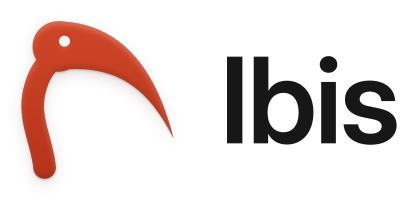

<h1 align="center">
  <picture>
    <source media="(prefers-color-scheme: dark)" srcset="brand/exports/ibis-logo-on-dark.svg">
    
  </picture>
</h1>

<p align="center"><strong>Your next citation, a shortcut away.</strong><br>Search your libraries, copy a citation key or a formatted citation, and paste it where you write.<br><a href="https://ibiscite.org">ibiscite.org</a></p>

Ibis is free and open source. Searching and copying work offline after setup. Ibis adds no analytics and never changes your libraries. See [privacy and local storage](PRIVACY.md) for runtime data and optional update checks.

## What it does today

Ibis is an early preview.

- Open the picker with **Ctrl+Shift+Y** on Windows or Linux/X11, or **Control+Command+R** on macOS, if the shortcut is available. On Wayland, use the application launcher; XWayland shortcut registration does not guarantee activation from native Wayland apps. Native Wayland shortcuts are being added in [#782](https://github.com/ibiscite/ibis/issues/782) and have not shipped.
- Search a `.bib` file or, while Zotero is open, your Zotero library and any group libraries you choose.
- Copy a citation key for Pandoc, BibLaTeX, LaTeX or Typst, or a formatted citation in APA, Chicago, Harvard, IEEE or MLA, then paste it where you write.
- Works offline and never changes your library.
- **Nightly only, until the next release:** start Ibis when you log in, and paste a DOI, ISBN, PubMed ID (`PMID:…`) or arXiv ID to find that record in your library (Ibis does not fetch it from the internet).

Ibis copies the citation for you to paste; inserting it directly is planned. See the [roadmap](ROADMAP.md) for what comes next, including more styles, Zotero while it is closed, and library health checks.

## Install

There are two builds. Both are free, run on Windows, macOS and Linux, and install as separate apps, so you can keep both.

- **Ibis** is the numbered preview release: [Mac (Apple silicon)](https://github.com/ibiscite/ibis/releases/download/stable/Ibis-macOS-Apple-silicon.dmg) · [Mac (Intel)](https://github.com/ibiscite/ibis/releases/download/stable/Ibis-macOS-Intel.dmg) · [Windows](https://github.com/ibiscite/ibis/releases/download/stable/Ibis-Windows-setup.exe) · [Linux AppImage](https://github.com/ibiscite/ibis/releases/download/stable/Ibis-Linux.AppImage) ([all releases](https://github.com/ibiscite/ibis/releases)).
- **Ibis Nightly** has the newest work and is rebuilt regularly from main, so it may be unfinished: [Mac (Apple silicon)](https://github.com/ibiscite/ibis/releases/download/nightly/Ibis-macOS-Apple-silicon.dmg) · [Mac (Intel)](https://github.com/ibiscite/ibis/releases/download/nightly/Ibis-macOS-Intel.dmg) · [Windows](https://github.com/ibiscite/ibis/releases/download/nightly/Ibis-Windows-setup.exe) · [Linux AppImage](https://github.com/ibiscite/ibis/releases/download/nightly/Ibis-Linux.AppImage) ([release page](https://github.com/ibiscite/ibis/releases/tag/nightly)).

On Linux you can also use the `.deb` on either release page or [install Ibis with Nix](docs/nix.md). See [compatibility](docs/compatibility.md) for tested systems, runtime requirements and AppImage FUSE help.

**The first time you open it.** The apps are not signed by Apple or Microsoft yet, so your system warns before opening them:

- **macOS:** open the `.dmg`, drag Ibis to Applications and open it. If macOS says it cannot check the app, open **System Settings > Privacy & Security**, scroll down and choose **Open Anyway**.
- **Windows:** run the installer. For a SmartScreen warning, check that the file came from the release page above; if you trust it and **More info > Run anyway** is available, you can continue. Smart App Control and work or school policies may block it without that option. For Smart App Control, [tell us](https://github.com/ibiscite/ibis/issues/new/choose) and wait for a trusted, signed build; there is no per-app exception. For a managed device, ask IT to review and approve Ibis. Keep protection enabled. If WebView2 Runtime is missing, the installer downloads it once, which needs an internet connection.
- **Linux:** make the AppImage executable (`chmod +x Ibis-Linux.AppImage`, or tick "Allow executing" in its file properties) and open it.

On first start, Ibis asks whether to check for updates. If you say yes, it can update itself; updates are signed and checked before they install. The menu bar or tray menu shows which build and version you are running.

Some Linux desktops, including GNOME without a tray extension, show no tray icon. Use the launcher to reopen Ibis and the picker's **More** menu for library choices and Quit. Nightly also has its start-at-login switch there. Update controls still need the tray menu.

## First use

1. Press the shortcut. The first time, Ibis offers Zotero if it is open and lists `.bib` files in your Documents, Desktop and Downloads folders; pick one, or choose **Choose library…** for any other file. It also asks where you write and sets the copy format to match.
2. Search by author, title, year, journal, citation key or keywords. You can combine words from different fields. Use the arrow keys to pick a reference.
3. Press **Enter** to copy the citation, then paste it into your document. **Shift+Enter** adds several references to one citation. Press **Ctrl+/** (**⌘/** on macOS) to see every key.

Hide or show the citation output with **Show what will be pasted** in **More**, or **Ctrl+I** (**⌘I** on macOS). Ibis remembers this choice; the references you added stay selected.

## Use with Zotero

With Zotero open, choose **Use Zotero** in the picker (or **Use Zotero Library** in the menu bar or tray menu). Ibis reads your personal library through Zotero's local API, on your computer only, and checks it for changes each time the picker opens. It never changes anything in Zotero.

The first time, turn on Zotero's local API: in Zotero, open **Settings > Advanced** and tick **Allow other applications on this computer to communicate with Zotero**. Ibis tries Zotero's own Citation Key field first, then a `Citation Key:` line in Extra, then the citation key in Zotero's CSL export (for example a Better BibTeX key).

If you prefer a file, or Zotero is usually closed, let Zotero keep a `.bib` file up to date instead:

1. Install the [Better BibTeX](https://retorque.re/zotero-better-bibtex/installation/) plugin for Zotero.
2. In Zotero, right-click **My Library** (or a collection) and choose **Export Library…** (or **Export Collection…**).
3. Choose the **Better BibLaTeX** format, tick **Keep updated**, and save the file somewhere that stays put.
4. In Ibis, choose that file as your library.

Better BibTeX rewrites the file whenever your library changes, and Ibis reloads it automatically. Ibis only reads the file; it never changes Zotero or the export.

## Help and feedback

Ask questions in [GitHub Discussions](https://github.com/ibiscite/ibis/discussions). Report a problem or suggest an idea through [the issue forms](https://github.com/ibiscite/ibis/issues/new/choose), or with **Report a Problem** and **Suggest an Idea** in the app's menu.

## Try the command line tool (developers)

```sh
cargo run -p ibis -- search "garcia sleep" --bib fixtures/bibtex/real-world.bib
cargo run -p ibis -- cite mueller2021 vanderberg2019 --page mueller2021=12-14 --format autocite
cargo run -p ibis -- check fixtures/bibtex/damaged.bib
```

## Contributing

You do not need to be a programmer to help. Reporting an app where pasting fails, adding a test example, or improving documentation are all valuable. AI-assisted contributions are welcome under clear rules. Start with [CONTRIBUTING.md](CONTRIBUTING.md).

## License

Ibis is licensed under the [GNU Affero General Public License v3.0 or later](LICENSE). Contributions use the [Developer Certificate of Origin](https://developercertificate.org/). See also [PRIVACY.md](PRIVACY.md), [SECURITY.md](SECURITY.md), [GOVERNANCE.md](GOVERNANCE.md), [TRADEMARKS.md](TRADEMARKS.md) and the [code signing policy](docs/code-signing.md).

Citation styles come from the [Citation Style Language](https://citationstyles.org/) project (CC BY-SA 3.0).
